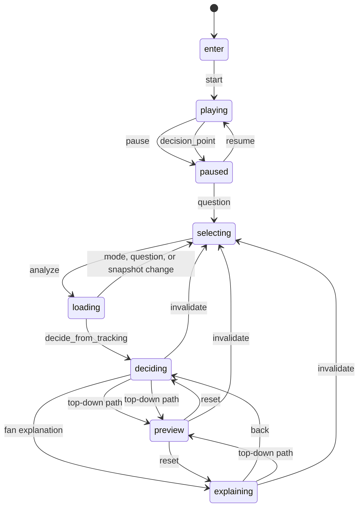

# Decision flow

Main demo page: [flow.html](flow.html). It plays the checked-in `sample_25hz_10min` clip (`clip.jsonl`, centre-origin metres) and pauses on each `decision_point`. The HUD is a stub of SysModel `decide_from_tracking`: four-way softmax (`probs`), `primary` and `secondaries`, and one path per action class. Pass and dribble paths include `score`. That number stays in the payload and is not drawn. Nothing on the page is a completion percentage.

The pitch reuses the three.js broadcast and top-down cameras in this package. Club and player names are read from sample metadata at runtime. The page does not ship real club marks.

```sh
npm install
npm run dev
```

Open http://127.0.0.1:5174/flow.html . The pitch-only sample stays at `/`.

The page is two columns. The picture is the three.js pitch. The bar under the picture holds playback, the four moments, and the four-class shares. The right rail holds a settings button for language and fan or coach, the question chips, the explanation, and a text box. A typed question uses the same mock explanation. Arrow geometry still comes from `decide_from_tracking`. A small top-down inset sits on the broadcast view once the distribution is revealed. It hides during the hypothetical preview and on a narrow window.

Still frames of that page are in [proof/flow](proof/flow).

Deep links, still without a reload: `?at=e000005`, `?demo=deciding`, `?demo=preview`, `?demo=explain`, `?demo=trace`, `?mode=coach`, `?lang=zh`.

## State machine

`src/flow/machine.ts` is the reducer. Playback, the mock client, and the panels only render this state. Changing mode, question, or snapshot bumps `requestId` and clears `decide`, agent text, the reveal, and the preview in the same update. A late mock response with the old id is ignored. Agent text is also dropped when `candidate_set_id` does not match the decision, and the distribution stays.

`traceOpen` is a panel flag, not a phase. It lists `agent_trace` entries (`agent`, `tool`, `ms`, `ok`).



Coach mode resolves into `deciding` with `revealed` false. The user picks pass, shoot, dribble, or hold, then `reveal` enters `explaining` and shows the distribution. Changing that pick hides the distribution and clears the agent text immediately.

`preview` forces the top-down camera, moves a marker along the chosen class path, and keeps the bilingual badge `Hypothetical / 假设推演`. Reset returns to the same snapshot. The recorded class is a solid ink mark. Every other class is dashed purple. Hold is a ring. Red and green are not used as right and wrong.

## Clients

`DecisionFlowClient` in `src/flow/client.ts` is the only call site (`decide`, `explain`). `createMockClient` fills it from the sample event and a local softmax. It does not read a key and it does not call Foundry. A later client can replace those two methods without changing the reducer.
